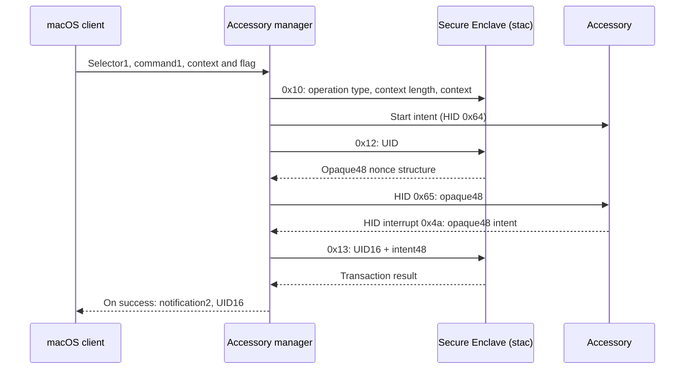

# Secure-intent operation and notification path

Evidence is **static**, from the local AppleTrustedAccessory driver. No operation,
pairing change, notification registration, or enclave transaction was executed.
Focused functions: `evidence/intent-and-pairing-functions.txt`.

## Recovered sequence



This diagram describes the observed host path and its guards, not a successful
live trace. The start routine enumerates ready accessories; it does not select
an accessory by a UID in the start payload. The `0x12` result must contain at
least48 bytes before it reaches the accessory setter
(`fffffe000a099400..fffffe000a099428`).

## Start and cancel buffers

Selector1 accepts command1/version1 and a payload of at least41 bytes:

| Offset | Size | Observed use |
| --- | ---: | --- |
| 0 | 4 | Operation type, opaque enum |
| 4 | 4 | Context length, 0–32 |
| 8 | 32 | Reserved context region |
| 40 | 1 | Flag controlling later operation state |

The manager builds a **new zero-initialized40-byte buffer** for stac `0x10`,
copies only the declared context bytes, and excludes byte40. Nonzero padding
from a supplied host buffer is not forwarded in that construction.
Source: `fffffe000a09810c`, `fffffe000a098294..fffffe000a0982d8`.

After successful detection, the state controlled by byte40 can trigger cancel
with status1. If the operation remains active, the manager generates another
nonce. Source: `fffffe000a09c9e0..fffffe000a09ca14`. The lab retains the field
name `flag40`; interpreting it as a public API option still needs a caller trace.

Selector2 checks version1 and cancels for the calling IOService. In the observed
branch it does **not** check header.command or consume the body. The caller's
service identity is a separate condition that the byte codecs cannot reproduce.
Source: `fffffe000a096184..fffffe000a09619c`.

## Detection is checked by the enclave

`secureIntentDetected` wraps the48-byte accessory structure in OSData and queues
an event of type3. In `accessoryEventHandler`, the manager requires an active
operation, validates that the queued object is OSData of exactly48 bytes,
and builds `UID16 | intent48` for transaction `0x13`.

Anchors: active state at `fffffe000a09c858..fffffe000a09c860`; length check at
`fffffe000a09c898..fffffe000a09c89c`; assembly and submission at
`fffffe000a09c944..fffffe000a09c99c`. A nonzero transaction result branches away
before the success notification. The bytes alone therefore do not establish
that the enclave recognizes the intent.

The accessory interrupt envelope is report ID `4a` plus48 bytes. This uses a
different path from ordinary pairing replies and their four-byte request counter.

## Client notification bodies

`AppleTrustedAccessoryManagerUserClient::message` accepts service messages
`0xe3ff8001` and `0xe3ff8002` only from its manager. Its builder selects Mach
message ID1 or2 and requests a16-byte body.

| Mach message ID | Body fields written by the builder |
| --- | --- |
| 1 | Little-endian uint32 status at0; remaining12 bytes uncharacterized |
| 2 | Accessory UID16 |

Source: manager identity/type gate at `fffffe000a0a0840..fffffe000a0a0858`;
body capacity at `fffffe000a0a0928`; builder at `fffffe000a0a0a14..fffffe000a0a0a84`.
The codec models **only these bodies**, not Mach header layout, port rights,
registration, or callback delivery. Status-body reserved bytes are preserved;
zero filling is a lab default, not an observed native guarantee.

On the successful intent path, service message `0xe3ff8002` carries UID16
(`fffffe000a09c9c8..fffffe000a09c9dc`). Cancellation later emits `0xe3ff8001`.
Observed callers pass status3 for cancellation/disconnect cleanup and status4
for timeout; these uses do not establish an exhaustive enum definition.

## Offline commands

```sh
python3 -m touchid_lab encode operation start '{"operation_type":3,"context":"414243","flag40":1}'
python3 -m touchid_lab encode operation cancel '{"command":1}'
python3 -m touchid_lab decode notification 1 04000000000000000000000000000000
python3 -m touchid_lab decode stac_response 0x2 0100
```

These commands only transform bytes. `intent.py` has no hardware I/O or
cryptographic validator. Neither receiving a synthetically encoded notification
nor parsing a nonce is a native authentication result.
